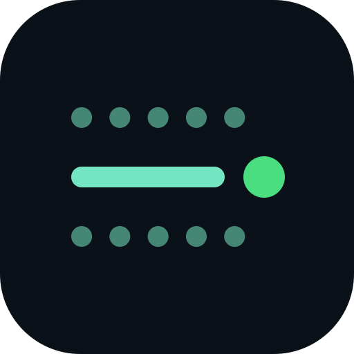

# Lanecast

[lanecast.live](https://lanecast.live)

<br clear="left">

Lanecast is all-in-one, easy-to-use software that puts on professional YouTube Live streams of swim meets.

If you're reading this, you're probably the team's designated tech person: the one who got voluntold to "take a look at" the timing system and scoreboard. Now you spend your Saturday mornings wrangling cables on a hot pool deck. Don't worry, you are not alone!

Lanecast is free and extensible. It's written by AI with a human touch, and it's easy (and quite fun) to customize your own themes with AI too: a theme is a folder of ordinary web files, and [docs/themes.md](docs/themes.md) tells you, or your assistant, everything there is to know.

Use Lanecast as much as you want; you owe nothing in return. If you'd like to pay it forward, tips are welcome.

We can't offer direct support, but we document things as well as we can, and AI tools give great advice: send one a link to this page and ask away.

Have fun, and tell your friends!

## How it works

Lanecast reads the timing console and HY-TEK Meet Manager over serial, will take the camera over the network, composites the overlays and sends the program out — on Linux, Windows and macOS, from a single install.

**Status: early.** The data side works: timer in, Meet Manager in, overlay feed out, with a simulated meet for trying it without hardware. Cameras come in over RTSP and play in the window under the theme's overlay; themes are folders of web files you (or your AI assistant) write, see [docs/themes.md](docs/themes.md). The YouTube encoder is next; see [docs/architecture.md](docs/architecture.md) for the plan.

## What it does today

Five tabs across the top. Each tab's dot turns green when that part is ready to go, and stays quiet otherwise. The Timer, Events and Cameras tabs each have their own **Simulate** switch: flip one and that tab's real controls make way for the simulation's, and the tab wears a *Sim* badge. Stream never does: it is idle or **Live**, nothing else. Any mix works: a real timer against made-up start lists, a photo of your pool against a made-up race.

| Tab | What it does | Simulated | Green when |
| --- | --- | --- | --- |
| **Stream** | The program, as large as the window allows: the camera under the theme's overlay, the theme's control panel (if it has one) in a drawer down the right that you can resize by its edge or hide. One thin bar above holds **Go Live** (not built yet), **Configure**, and the simulation control when the timer is simulated; Configure holds the program camera, the overlay feed (a WebSocket server on port 8080 inside the app; every scoreboard change goes to every overlay connected) and, later, the stream key. | Cannot be: it is the composite of the others | the program has a picture |
| **Timer** | Pick the serial port the console's scoreboard output is on and press Connect. Shows the running clock, event/heat, race state and every lane. | A pretend console, driven from the fold-away **Simulation control** above the program on the Stream tab: queue an event and heat from the start lists loaded, then **Run**: lineup, race with splits, results, next heat, through every event, round and round; off again to stop where it is. | the console's clock is arriving |
| **Events** | Pick the port on Meet Manager's scoreboard link and press Connect. Start lists accumulate as Meet Manager sends them and are kept between runs. Load reads Meet Manager's `.scb` export files, Save writes them back out, the browser steps through events and heats, and a click on a lane edits the swimmer or team in place. | No port, no Load or Save. **Fetch simulated events** makes a dozen events with made-up swimmers, mostly 25s, 50s and 100s (nobody wants to test a simulated 500). Simulated start lists are kept apart from real ones. | start lists are in hand |
| **Camera** (Cameras, once there is more than one) | Add a camera and watch it live in the window: one attached to this computer (a webcam, a capture card, an iPhone as a camera on a Mac) with one click from the list, or a network camera by its RTSP address. Network pictures come through [go2rtc](https://github.com/AlexxIT/go2rtc), which the app runs beside itself; nothing else to install. | A photo or video taken from where the camera will stand, so the overlays can be judged against the real view. | a camera's picture is arriving |
| **Theme** | Which theme draws the stream: the built-in **Classic** and **Template**, and your own. A theme is a folder of web files: an overlay drawn over the picture, a control panel in the Stream tab if it wants one, and it may cut cameras and place them. **New theme from the template** copies the starting point into your themes folder; an AI assistant pointed at [docs/themes.md](docs/themes.md) can do the rest. | Cannot be: nothing external feeds it | the theme's overlay is up |

No baud rates or parity to set: each link has one correct setting and the app uses it. A port that was connected when the app closed is reconnected at launch; a port that drops out is reopened when it comes back.

## Running it

Needs [Node.js](https://nodejs.org) 20 or newer.

```bash
npm install
npm start
```

Without hardware, flip the **Simulate** switch on each tab you are missing. Nothing is simulated the first time; after that the app starts the way it was left, switches, chosen photo and all (settings live in a `lanecast.json` in the app's data folder).

To work on the look of the window without launching Electron, serve the folder and open the page in a browser; `mock.js` stands in for the app's bridge with the same simulated meet and a drawn camera:

```bash
python3 -m http.server 8875
```

then open `http://localhost:8875/src/renderer/index.html`. Nothing there is real, but every tab, dot, badge and control is there to style.

`npm install` also fetches the go2rtc binary for your machine into `vendor/` (`npm run fetch-go2rtc` to do it again).

Tests run without Electron:

```bash
npm test
```

A full check of the app on the simulated ports, including a screenshot:

```bash
npx electron test/smoke.js shot.png
```

## Installers

`npm run dist` builds the installer for the OS it runs on into `dist/`. The [build workflow](.github/workflows/build.yml) builds all three when a `v*` tag is pushed. Builds are unsigned for now: on macOS right-click → Open the first time; Windows SmartScreen will warn. On Linux, add yourself to the `dialout` group to open serial ports.

## At the pool

- The console's **scoreboard output** and Meet Manager's **scoreboard link** are two separate cables; each needs its own USB serial adapter. Lanecast only listens on both.
- Meet Manager's link has two directions on separate wires. Tap the one Meet Manager transmits on; if the Meet data panel says it is seeing the scoreboard computer's line, move the tap to the other wire.
- Overlays (an OBS browser source today, Lanecast's own compositor later) connect to `ws://<this machine>:8080/`. The panel shows the address.
- Cameras: a webcam, a capture card or an iPhone (Continuity Camera; unlock the phone and keep it near the Mac) appears under *On this computer* after **Find cameras**, which asks for camera access once. A network camera goes on the same network, set to **H.264**, and is added by its RTSP address (for most PTZ cameras `rtsp://<camera ip>/1`, with `user:password@` in front if it asks). An NDI camera's RTSP output is the same picture; NDI itself is on the list.

Protocol notes, reconstructed from captures of real meets: [timer](docs/timer-protocol.md), [Meet Manager](docs/meet-manager-link.md). Keep captures and start-list files with athlete names out of the repository; `.gitignore` already excludes `*.scb`, `*.csv` and `captures/`.

## Licence

MIT. See [THIRD_PARTY_NOTICES.md](THIRD_PARTY_NOTICES.md) for the reference implementation that informed the timer decoding.
