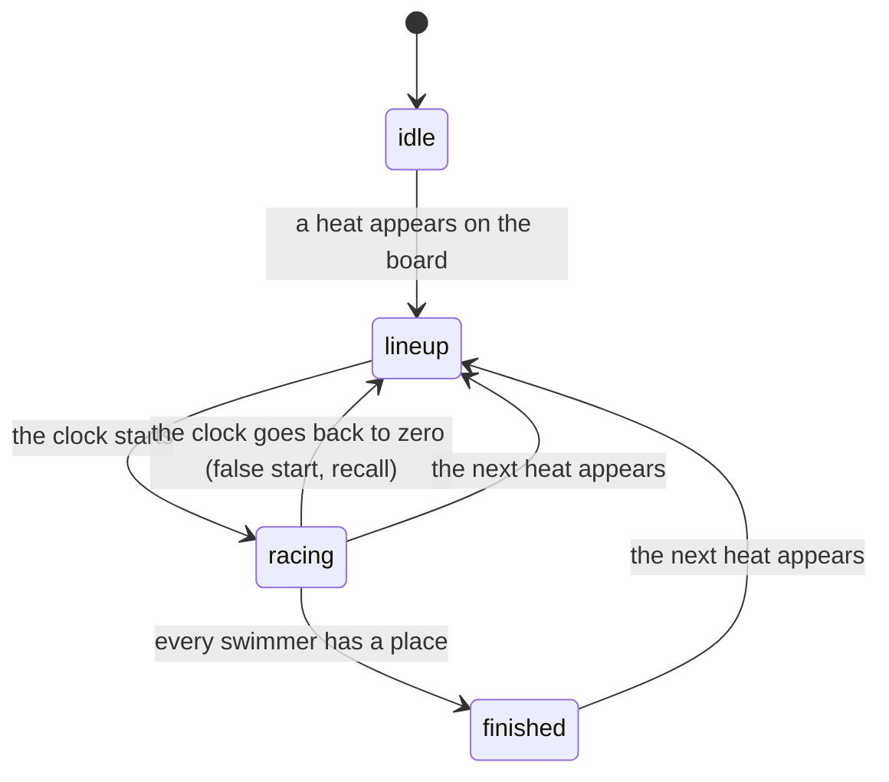

# Theme messages: everything a theme is told

A theme learns about the meet from two kinds of message: **`state`**, the whole scoreboard as it stands, and **events**, the things that happen, once each. This page gives each one exactly, with examples, and then [a whole heat played out message by message](#a-whole-heat-message-by-message).

Companions: [the brief for agents](making-a-theme.md) · [working code](theme-cookbook.md) · [the full reference](../themes.md)

## How they arrive

A page receives messages through the runtime, never directly:

```js
Lanecast.on('state', s => { /* the scoreboard, whenever it changes */ });
Lanecast.on('heat.finish', e => { /* one event, by its name */ });
Lanecast.on('*', (name, message) => { /* everything, for debugging */ });
```

Inside Lanecast (and in [the preview page](making-a-theme.md#seeing-your-work)) the page is in a frame and the messages come from the app. Opened by itself in a browser, or as a browser source in OBS, the runtime instead connects to the app's feed at `ws://localhost:8080/` (or `?feed=ws://host:port/` in the page's address) and gets the same `state` and events; there, the calls that ask something of the app do nothing.

Every message is plain JSON with a `type` and a version, `v`, currently `2`.

## At the start: `hello`, then `settings`

When a page loads, the runtime tells the app it is ready and the app answers. You rarely need these two; they are here so nothing is a surprise.

```json
{ "type": "hello", "theme": { "id": "u-dolphins-2026", "name": "Dolphins 2026" }, "size": { "width": 1280, "height": 720 }, "settings": { "accent": "#ffcc33" } }
```

`Lanecast.on('hello', fn)` fires once. Straight after it, `Lanecast.on('settings', fn)` fires with the theme's saved settings (an empty object for a theme that has saved none), and again whenever any page of the theme calls `Lanecast.saveSettings`. Then the latest `state` is sent, so a page that loads in the middle of a race can draw at once.

## `state`

The whole scoreboard. Sent whenever anything in it changes: up to ten times a second while a clock runs, about once a second when nothing moves.

```json
{
  "type": "state", "v": 2,
  "event": 12, "heat": 1, "heats": 2, "title": "Girls 11-12 100 Free",
  "clock": "0:14.3", "running": true, "phase": "racing",
  "lanes": [
    { "lane": 1, "name": "", "team": "", "time": "", "place": null, "followsClock": false },
    { "lane": 2, "name": "", "team": "", "time": "", "place": null, "followsClock": false },
    { "lane": 3, "name": "Ana Ruiz", "team": "OTTR", "time": "", "place": null, "followsClock": true },
    { "lane": 4, "name": "Bea Stone", "team": "DOLF", "time": "0:09.66", "place": null, "followsClock": false },
    { "lane": 5, "name": "Cy Vale", "team": "RAYS", "time": "0:20.74", "place": 2, "followsClock": false },
    { "lane": 6, "name": "Dee Okoro", "team": "WAVE", "time": "", "place": null, "followsClock": true },
    { "lane": 7, "name": "", "team": "", "time": "", "place": null, "followsClock": false },
    { "lane": 8, "name": "", "team": "", "time": "", "place": null, "followsClock": false },
    { "lane": 9, "name": "", "team": "", "time": "", "place": null, "followsClock": false },
    { "lane": 10, "name": "", "team": "", "time": "", "place": null, "followsClock": false }
  ],
  "cameras": [
    { "id": "cam-x1", "name": "Wide", "steerable": true, "positions": ["Whole pool", "Blocks", "Finish line"] },
    { "id": "cam-x2", "name": "Finish", "steerable": false, "positions": [] }
  ],
  "camera": "cam-x1"
}
```

| Field | Type | Meaning |
| --- | --- | --- |
| `event` | number or `null` | The event number on the timing console. `null` when the board is blank: draw nothing |
| `heat` | number | The heat number on the console |
| `heats` | number | How many heats the start lists have for this event. `0` when no start list is loaded for it |
| `title` | string | The event's name from the start lists, such as `"Girls 11-12 100 Free"`. `""` without one |
| `clock` | string | The running clock exactly as the console shows it: `"m:ss.t"`, tenths. Show it as given |
| `running` | boolean | The clock is advancing |
| `phase` | string | Where the race is: `"idle"`, `"lineup"`, `"racing"` or `"finished"`. See [below](#phase) |
| `lanes` | array of 10 | Always ten, lane 1 first, whether or not the pool has ten |
| `lanes[i].lane` | number | 1 to 10 |
| `lanes[i].name`, `.team` | string | From the start lists. `""` for an empty lane, and for every lane when no start list is loaded. Names are `"First Last"` |
| `lanes[i].time` | string | What the lane's display shows: `"m:ss.hh"`, hundredths. A split while swimming (it stays a few seconds, then clears), the final time once `place` is set. `""` when it shows no time |
| `lanes[i].place` | number or `null` | The place the console gave, once the lane has finished |
| `lanes[i].followsClock` | boolean | That lane's display is showing the running clock: the swimmer is still in the water |
| `cameras` | array | The cameras set up, in the person's order |
| `cameras[i].id`, `.name` | string | The name is what the person typed on the Camera tab |
| `cameras[i].steerable` | boolean | It can be panned, tilted and zoomed from the app right now |
| `cameras[i].positions` | array of strings | The names of the places saved for it. Empty unless steerable |
| `camera` | string or `null` | The `id` of the camera on the program |

Things to rely on, and not to:

- A lane is **occupied** if it has a `name`. With no start lists, tell an occupied lane by its having a `time` or `followsClock`.
- A lane has **finished** if `place` is not `null`.
- Sort finishers by `place`, not by `time`: the console decides the places.
- `time` and `clock` are strings for showing. If you need a number, parse it, but never show a clock or time you computed yourself.

### `phase`



| `phase` | The board shows | A theme usually |
| --- | --- | --- |
| `idle` | nothing; no event | draws nothing |
| `lineup` | an event and heat, clock at zero | shows who is in which lane |
| `racing` | the clock running; splits and finishes arriving | shows the clock, and times as they come |
| `finished` | every swimmer with a name has a place | shows the results |

Without start lists the app cannot know who is swimming, so `finished` comes when the clock has been stopped for a second and a half after the first finish.

## Events

An event says something happened. Each is sent once, when it happens. Every event message has `"type": "event"`, `"v": 2`, a `name`, and the fields below. `swimmer` and `team` are `""` when no start list names that lane.

### `event.change`

A different event number is on the board. Sent before that event's first `heat.lineup`.

```json
{ "type": "event", "v": 2, "name": "event.change", "event": 12, "title": "Girls 11-12 100 Free", "heats": 2 }
```

### `heat.lineup`

A new event and heat are on the board, not yet started. `lanes` lists only the lanes with a name; it is empty without start lists.

```json
{ "type": "event", "v": 2, "name": "heat.lineup", "event": 12, "heat": 1, "title": "Girls 11-12 100 Free",
  "lanes": [ { "lane": 3, "swimmer": "Ana Ruiz", "team": "OTTR" }, { "lane": 4, "swimmer": "Bea Stone", "team": "DOLF" } ] }
```

### `race.start`

The clock started.

```json
{ "type": "event", "v": 2, "name": "race.start", "event": 12, "heat": 1, "title": "Girls 11-12 100 Free" }
```

### `race.reset`

The clock went back to zero after a start: a false start or a recall. The heat is lined up again, but `heat.lineup` is **not** sent again. Splits and finishes will be sent afresh after the next `race.start`.

```json
{ "type": "event", "v": 2, "name": "race.reset", "event": 12, "heat": 1 }
```

### `lane.split`

A lane shows a time without a place: an intermediate time. A pool takes one at every 50, so a 200 gives three splits and then the finish, a 100 gives one, and a 50 or a 25 gives none.

```json
{ "type": "event", "v": 2, "name": "lane.split", "event": 12, "heat": 1, "lane": 4, "swimmer": "Bea Stone", "team": "DOLF", "time": "0:09.66" }
```

### `lane.finish`

A lane shows a place and a time: that swimmer has finished.

```json
{ "type": "event", "v": 2, "name": "lane.finish", "event": 12, "heat": 1, "lane": 4, "swimmer": "Bea Stone", "team": "DOLF", "place": 1, "time": "0:20.13" }
```

Finishes arrive in the order the swimmers touch, so `place` is usually 1, then 2, and so on; do not depend on it.

### `heat.finish`

The heat is over: every lane with a name has finished (or, without start lists, the clock stopped a second and a half after the first finish). `results` is every finisher, sorted by place. This is the moment for a results board.

```json
{ "type": "event", "v": 2, "name": "heat.finish", "event": 12, "heat": 1, "title": "Girls 11-12 100 Free",
  "results": [
    { "lane": 4, "swimmer": "Bea Stone", "team": "DOLF", "place": 1, "time": "0:20.13" },
    { "lane": 5, "swimmer": "Cy Vale", "team": "RAYS", "place": 2, "time": "0:20.74" }
  ] }
```

### `event.finish`

`heat.finish` was for the last heat the start lists know of. Sent straight after that `heat.finish`. Never sent without start lists, because the app cannot know which heat is the last.

```json
{ "type": "event", "v": 2, "name": "event.finish", "event": 12, "title": "Girls 11-12 100 Free", "heats": 2 }
```

### Between a theme's own pages

Not from the meet, but they arrive the same way.

| `Lanecast.on(…)` | In | Carries |
| --- | --- | --- |
| `'control'` | the overlay and any dialog | whatever the control panel passed to `Lanecast.send(data)` |
| `'overlay'` | the control panel and any dialog | whatever the overlay passed to `Lanecast.send(data)` |
| `'dialog'` | the overlay and the control panel | whatever a dialog passed to `Lanecast.send(data)` |
| `'settings'` | every page | the theme's saved settings, at the start and after each `Lanecast.saveSettings` |

## What a theme can count on

- **Order.** `event.change` comes before `heat.lineup`. Every `lane.finish` of a heat comes before its `heat.finish`. `heat.finish` comes before `event.finish`.
- **Once each.** No event is repeated for the same thing. A lane's split is sent once per split; its finish once.
- **`state` is always enough to draw.** A theme switched on mid-race gets `state` at once and none of the events it missed. Draw the board from `state`; use events to animate.
- **Nothing arrives for a blank board.** While `event` is `null` there are no events.

And what it cannot:

- **That names exist.** Start lists may not be loaded, or may not cover this event.
- **That every swimmer finishes, or that `heat.finish` comes.** With start lists, a heat is finished when every named lane has a place; a swimmer who does not show never gets one, and that heat's `heat.finish` is never sent. Do not make a graphic that can only be taken down by `heat.finish`: take it down on `heat.lineup` too.
- **That `event.finish` comes.** It needs start lists.
- **That events are evenly spaced.** A meet runs long gaps and sudden bursts. Do not queue animations that assume one at a time; six finishes can land inside a second.

## A whole heat, message by message

Event 12, heat 1 of 2: a 100 Free with swimmers in lanes 3 to 8. `state` is sent throughout (ten times a second while the clock runs); only the moments where something changes are shown.

| Clock | Sent | What a theme does with it |
| --- | --- | --- |
| | `event.change` `{ event: 12, title: "Girls 11-12 100 Free", heats: 2 }` | a title card for the new event |
| | `heat.lineup` `{ event: 12, heat: 1, lanes: [six swimmers] }` | bring on the lineup |
| `0:00.0` | `state` with `phase: "lineup"`, `running: false`, six lanes with names and no times | draw the lineup |
| `0:00.1` | `race.start` `{ event: 12, heat: 1 }` | take the lineup off, cut to the race |
| `0:05.0` | `state` with `phase: "racing"`, `running: true`, lanes `followsClock: true` | show the clock |
| `0:09.6` | `lane.split` `{ lane: 4, swimmer: "Bea Stone", time: "0:09.66" }` | flash lane 4's split |
| `0:09.9` | `lane.split` for lane 5, then the others over the next second or two | |
| `0:12.6` | `state`: lane 4's `time` is `""` again and it `followsClock` | the split has left the board |
| `0:20.1` | `lane.finish` `{ lane: 4, swimmer: "Bea Stone", place: 1, time: "0:20.13" }` | the winner |
| `0:20.7` | `lane.finish` `{ lane: 5, place: 2, time: "0:20.74" }`, and so on to sixth | each place as it comes |
| `0:23.1` | `lane.finish` `{ lane: 3, place: 6, time: "0:23.18" }` | |
| `0:23.1` | `heat.finish` `{ event: 12, heat: 1, results: [six, by place] }` | the results board |
| | `state` with `phase: "finished"`; the clock stops a moment later, `running: false` | |
| | `heat.lineup` `{ event: 12, heat: 2 }` (no `event.change`: same event) | results off, next lineup on |
| | … heat 2 runs the same way … | |
| | `heat.finish` `{ event: 12, heat: 2 }`, then `event.finish` `{ event: 12, heats: 2 }` | results, then an event summary or a sponsor |
| | `event.change` `{ event: 13 }`, `heat.lineup` `{ event: 13, heat: 1 }` | the next event |

[The preview page](making-a-theme.md#seeing-your-work) plays exactly this.
